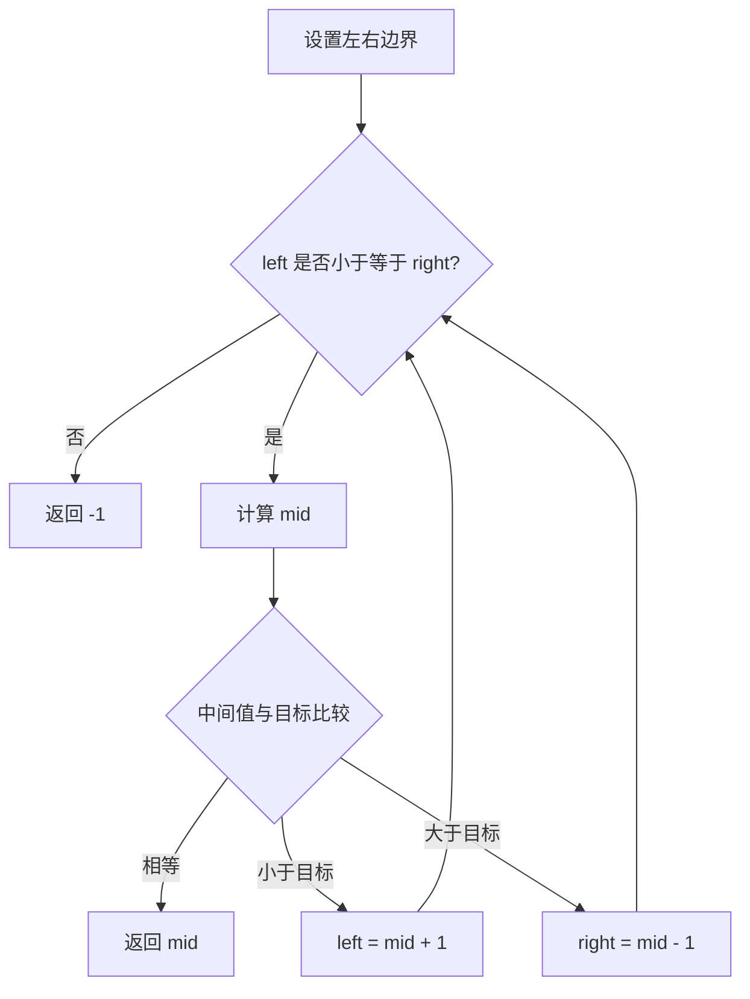

> [!NOTE]
> 这是一篇功能演示和写作模板，不代表站主真实的刷题记录。可以参照这个结构，用自己的题目、代码和复盘替换内容。

算法笔记不必从“标准答案”开始。先把自己采用的约定写清楚，再留下能够验证的过程，下一次遇到相似问题就有了起点。:seedling:

## 先说明问题

给定一个**升序排列、元素不重复**的数组，以及一个目标值，返回目标值的下标；不存在则返回 `-1`。

例如，在 `[2, 5, 8, 12, 16, 23, 38, 56, 72]` 中寻找 `23`，结果是 `5`。

这篇笔记采用闭区间 `[left, right]`。每次进入循环时，若目标存在，它就仍在这个区间内。

## 把过程走一遍

下面的组件可以切换目标值，再逐步观察左右边界与中点。尝试寻找 `20`，看看“不存在”是怎样得到确认的。

<AlgorithmSteps />

### 每一步在排除什么

中点对应的元素比目标小，就可以排除中点以及它左侧的所有元素；反过来，则排除中点以及它右侧的所有元素。



> [!TIP] 用边界解释代码
> 写下 `+ 1` 或 `- 1` 的原因：中点已经比较过，不需要再次保留。这也保证每次未找到时，区间都会缩小。

## 留下可运行的实现

```python title="binary_search.py" {4-5,9-12}
def binary_search(values: list[int], target: int) -> int:
    left, right = 0, len(values) - 1

    while left <= right:
        mid = left + (right - left) // 2
        if values[mid] == target:
            return mid

        if values[mid] < target:
            left = mid + 1
        else:
            right = mid - 1

    return -1


assert binary_search([2, 5, 8, 12, 16, 23, 38, 56, 72], 23) == 5
assert binary_search([2, 5, 8, 12, 16, 23, 38, 56, 72], 20) == -1
assert binary_search([], 23) == -1
```

### 用少量输入检查边界

| 输入 | 目标 | 期望结果 | 想检查什么 |
| --- | --- | --- | --- |
| `[]` | `23` | `-1` | 空数组不进入循环 |
| `[23]` | `23` | `0` | 区间只剩一个元素时仍要比较 |
| `[2, 5, 8]` | `2` | `0` | 最左侧元素 |
| `[2, 5, 8]` | `8` | `2` | 最右侧元素 |
| `[2, 5, 8]` | `6` | `-1` | 不存在的中间值 |

## 复杂度为什么是对数

每轮比较后，候选范围最多剩下一半。经过 $k$ 轮后，剩余规模大约为 $n / 2^k$。

$$
\frac{n}{2^k} \leq 1
\quad \Longrightarrow \quad
k \geq \log_2 n
$$

因此时间复杂度为 $O(\log n)$；代码只维护三个下标，额外空间复杂度为 $O(1)$。

> [!IMPORTANT]
> 这个结论依赖数组已经有序。如果输入需要先排序，完整方案还应计算排序的成本。

## 复盘时留下一个问题

- [x] 明确了闭区间约定。
- [x] 检查了空数组、首尾元素和不存在的目标。
- [ ] 如果元素重复，怎样找到第一个等于目标的位置？

最后一项可以留给下一篇笔记：先确定想找的是“任意位置”还是“第一个位置”，再调整循环不变量。[^invariant]

[^invariant]: 循环不变量是每次循环开始时保持成立的条件。这篇示例中，它就是“如果目标存在，则仍在当前闭区间里”。
